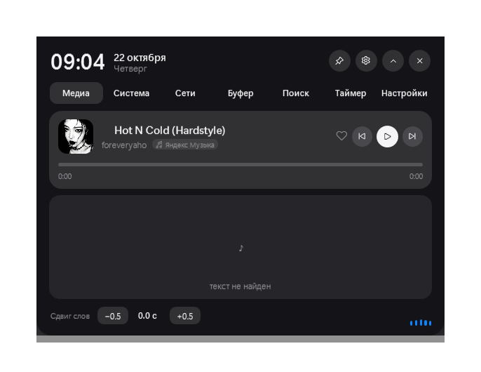
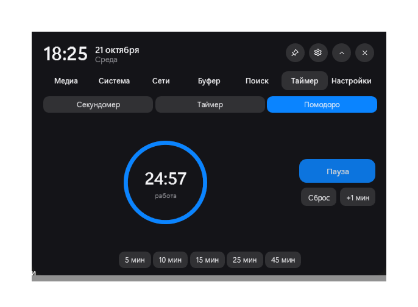
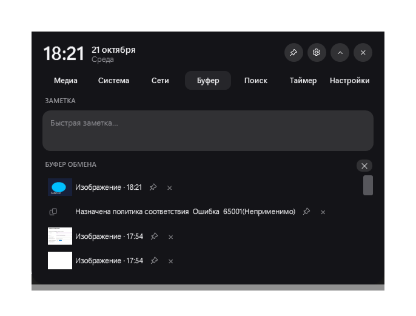

# Salli — Dynamic Island для Windows


[](https://github.com/ficksj/Salli/releases/latest)
[](https://ficksj.github.io/Salli/)

Аккуратный «динамический остров» в центре верхней кромки экрана. Музыка, система,
сеть, буфер обмена, поиск и таймер живут в одной плашке, которая раскрывается
за 0.4 секунды и плавно перетекает между состояниями — без дёрганья, мигания и
подвисаний интерфейса.



---

## Возможности

<table>
<tr>
<td width="50%" valign="top">

**Медиа**
- Обложка, трек, исполнитель, источник (Яндекс Музыка, Spotify, браузер…)
- Play/pause, следующий/предыдущий, избранное
- Прогресс воспроизведения и перемотка
- Текст песни с ручным оффсетом
- Живой эквалайзер: из звука системы или с микрофона

**Система**
- Загрузка CPU и памяти + топ процессов
- Громкость и яркость (DDC/CI для внешних мониторов)
- Батарея, температура, диск
- Ночной свет и «Не беспокоить»
- Режим стримера (скрывает название трека)

</td>
<td width="50%" valign="top">

**Сеть**
- Список Wi-Fi сетей и Bluetooth-устройств
- Устройства вывода звука
- **Микшер по приложениям**: своя громкость и mute для каждого приложения,
  сессии одного процесса управляются одним ползунком

**Буфер обмена**
- Текст и картинки (миниатюры + PNG на диске)
- Закрепление и удаление записей, очистка истории
- Быстрая заметка прямо в острове

**Поиск**
- Приложения из меню «Пуск» (с иконками)
- Калькулятор: `2+2`, `(18*3)/2`
- Валюты: `100 usd в rub`
- Поиск в интернете, если ничего не нашлось

</td>
</tr>
<tr>
<td valign="top">

**Таймер**
- Секундомер, обратный отсчёт, помодоро
- Пресеты 5/10/15/25/45 минут и +1 минута
- Кольцо прогресса в раскрытой панели и компактный чип в свёрнутой плашке
- Мягкий сигнал в конце

**Полноэкранный режим**
- Остров сам прячется, когда запущена игра или полноэкранное видео,
  и возвращается, когда вы выходите

</td>
<td valign="top">

**Оформление**
- 5 пресетов: Graphite, Midnight, Nord, Mono, Sand
- Светлая и тёмная тема, акцент из обоев
- «Стекло» — полупрозрачная поверхность
- Три размера: мини, обычный, крупный

**Языки и клавиатура**
- Русский и английский, переключение на лету
- Горячие клавиши, управление колесом мыши
- Автозапуск с Windows, иконка в трее

</td>
</tr>
</table>

## Скриншоты

<table>
<tr>
<td></td>
<td></td>
</tr>
<tr>
<td align="center"><sub>Помодоро: кольцо прогресса и чип в свёрнутой плашке</sub></td>
<td align="center"><sub>Буфер обмена: картинки, закрепление, быстрая заметка</sub></td>
</tr>
</table>

## Горячие клавиши

| Комбинация | Действие |
|---|---|
| <kbd>Ctrl</kbd> + <kbd>Alt</kbd> + <kbd>Space</kbd> | Открыть остров и перейти к поиску |
| <kbd>Ctrl</kbd> + <kbd>Alt</kbd> + <kbd>M</kbd> | Выключить / включить звук |
| Колесо мыши над плашкой | Громкость (можно отключить) |
| Клик в любом месте экрана | Свернуть остров (если он не закреплён) |
| <kbd>Enter</kbd> / <kbd>Esc</kbd> в поиске | Запустить / очистить |
| <kbd>↑</kbd> <kbd>↓</kbd> в поиске | Выбор результата |

## Запуск

**Готовый билд:** скачать [`Salli.exe`](https://github.com/ficksj/Salli/releases/latest) (~75 МБ,
самодостаточная сборка — .NET ставить не нужно) и запустить. SmartScreen может спросить:
«Подробнее» → «Выполнить в любом случае».

**Из исходников.** Нужен Windows 10 (19041+) или Windows 11 и [.NET 8 SDK](https://dotnet.microsoft.com/download).

```powershell
git clone https://github.com/ficksj/Salli.git
cd salli
dotnet build -c Release
.\bin\Release\net8.0-windows10.0.19041.0\Salli.exe
```

Собрать один самодостаточный `.exe` (не требует установленного .NET):

```powershell
dotnet publish -c Release -r win-x64 --self-contained true `
  -p:PublishSingleFile=true -p:EnableCompressionInSingleFile=true `
  -p:IncludeNativeLibrariesForSelfExtract=true
```

Настройки, заметка и картинки из буфера лежат в `%APPDATA%\Salli`.
Автозапуск включается в настройках или из меню в трее.

## Почему анимации плавные

Остров перерисовывается на каждом кадре, поэтому всё тяжёлое вынесено из UI-потока:

- WMI, DDC/CI, COM и WinRT-запросы выполняются в `Task.Run`, а в интерфейс
  возвращаются одним пакетом через `Dispatcher.InvokeAsync` — кадр никогда
  не ждёт железо.
- Высота панели «замораживается» на время морфинга, чтобы WPF не пересчитывал
  layout всего поддерева каждый кадр; размеры снимаются один раз до анимации.
- Тень отключается на время перехода, содержимое вкладок меняется кроссфейдом
  со сдвигом на 8 px, кривая — `QuinticEase.EaseOut` (440 мс раскрытие,
  300 мс сворачивание).
- Данные обновляются с задержкой после раскрытия (~620 мс), а не в момент клика.

## Структура

```
MainWindow.xaml(.cs)     окно-остров: морфинг, вкладки, вся интерактивность
SettingsWindow.xaml(.cs) большое окно настроек
Theme.cs                 пресеты, акцент, «стекло»
Loc.cs                   RU/EN-словарь и обход визуального дерева
AppSettings.cs           настройки, буфер обмена, миграции
Services/
  Devices.cs             звук, яркость, батарея, Wi-Fi/BT
  AppMixer.cs            микшер по приложениям (группировка по процессу)
  AudioDevices.cs        устройства вывода
  IslandTimer.cs         секундомер / таймер / помодоро
  Launcher.cs            поиск приложений, калькулятор, валюты
  ClipStore.cs           буфер обмена: картинки, миниатюры, хранение
  LyricsService.cs       текст песни
  FullscreenWatcher.cs   определение полноэкранных окон
  WeatherService.cs      погода в плашке
  SongRecognition / Mic  эквалайзер и микрофон
```

Проект без MVVM-фреймворков: один набор контролов, прямой код и Win32/COM-интероп.

## English

**Salli** is a Dynamic Island for Windows: a slim top-center bar that expands in
0.4 s into a panel with media controls and lyrics, system stats, Wi-Fi/Bluetooth,
a per-app volume mixer, clipboard history with images and pins, a launcher
(apps, calculator, currency, web), a timer/pomodoro with a progress ring, and
theme presets. Russian and English UI, configurable hotkeys, tray icon,
autostart, and automatic hiding in fullscreen apps.

Built with C# / .NET 8 / WPF, no UI frameworks, ~9.6k lines of C# and 1.4k of XAML.

## Лицензия

[MIT](LICENSE) © 2026 Kirill Beletskiy
